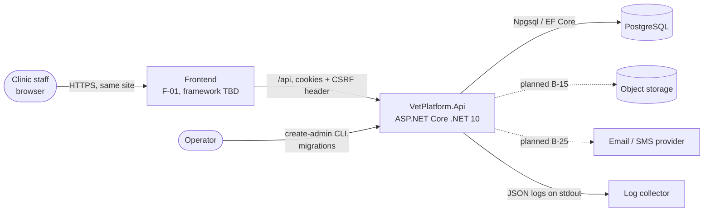
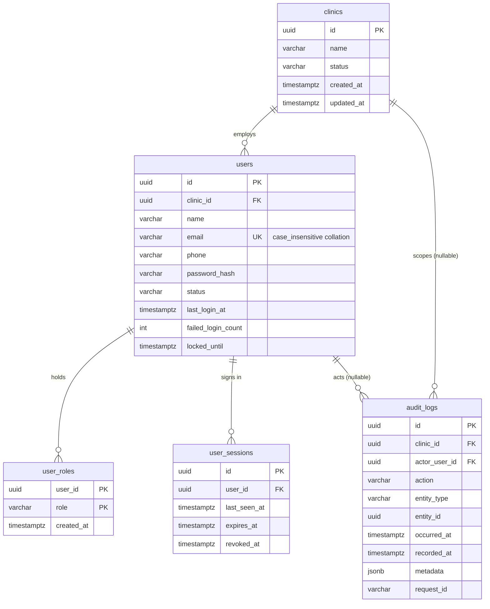
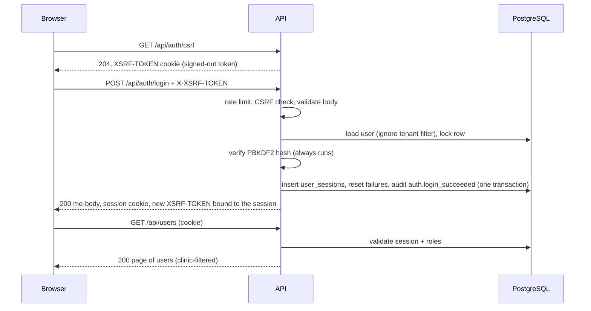

# Software Design Description (SDD)

Veterinary Management Platform. Version 1.0, 2026-10-13, written at the B-04 merge.

## 1. Introduction
This document describes how the platform is built: its structure, request flow, data design and the patterns every
new module follows. Requirements are in `SRS.md`; the reasoning behind each major decision is recorded once, in the
ADRs of `ARCHITECTURE.md` section 11, and only referenced here. If this document and an ADR disagree, the ADR wins
and this document must be fixed.

Sections 2–7 describe what exists (B-01 to B-05). Section 8 is the design to follow for planned modules.

## 2. System context



- The frontend and API share a site (SameSite=Strict cookies, no CORS). In development the frontend dev server
  proxies `/api` to `https://localhost:7096`.
- There is no public sign-up; an operator provisions each clinic with the CLI (ADR-004).

## 3. Architectural style (ADR-001)
A modular monolith: one deployable (`backend/src/VetPlatform.Api`), organised by feature.

```
src/VetPlatform.Api/
  Program.cs              composition root, middleware order, CLI dispatch
  Common/                 cross-cutting infrastructure, no business rules
    Errors/               error envelope, ApiException, global exception handler, model-state mapping
    Http/                 request id, request logging, paging, strict enum parsing
    Persistence/          AppDbContext, Entity base, timestamps interceptor, health check, Migrations/
    Security/             CSRF filter
    Authorization/        Role enum, permission catalogue, [RequirePermission], policy handler
    Tenancy/              ITenantContext, ClinicScopeInterceptor
    Auditing/             AuditLog entity, AuditTrail
  Features/
    Identity/             Clinic, User, UserRole, UserSession entities, password policy
    Auth/                 AuthController, AuthService, cookie session events, antiforgery binding
    Users/                UsersController, UserService, contracts, create-admin command
```

Layering inside a feature: **controller** (HTTP mapping, attributes, no logic) → **service** (business rules,
transactions, audit) → **AppDbContext** (EF Core; no repository layer, since the context already is one). Request and
response types are records in `<Feature>Contracts.cs`; entities never cross the API boundary.

Rules that keep modules separable later: a feature reaches another feature's data only through that feature's
service or its entities' navigation properties, never by duplicating its rules; `Common/` never depends on
`Features/` except where entity types are required by infrastructure (identity entities for session validation).

## 4. Request pipeline
Order is set in `Program.cs` and matters:

| # | Stage | Responsibility |
|---|---|---|
| 1 | `RequestIdMiddleware` | Accept a safe `X-Request-Id` or generate one; echo it; open the `CorrelationId` log scope. |
| 2 | `RequestLoggingMiddleware` | Log method, path, status, duration only (never query, headers, body). |
| 3 | Exception handler + status code pages | Turn any exception or bare status into the error envelope (`API.md` section 2). |
| 4 | HSTS | Outside Development only. |
| 5 | Rate limiter | Login/password policy: fixed window per client IP (IPv6 /64). Runs before authentication so throttled attempts cost no database work. |
| 6 | Authentication | Cookie handler; `SessionCookieEvents.ValidatePrincipal` re-validates the session on every request (6.1). |
| 7 | Authorization | Endpoint default `RequireAuthorization()`; `[RequirePermission]` policies; `[AllowAnonymous]` exceptions. |
| 8 | MVC filters | `CsrfProtectionFilter` on unsafe methods; model validation → `422`/`400` mapping. |
| 9 | Controller → service → `AppDbContext` | Business logic, with the tenant filter and write guard (6.2) and audit (6.3). |

Error precedence observed by clients (`API.md` section 3): `429` → `401` → `403 FORBIDDEN` →
`403 CSRF_TOKEN_INVALID` → `400`/`422` → endpoint result.

Unsafe endpoints must be controller actions because CSRF protection is an MVC filter; a test enforces it.

## 5. Data design (ADR-002)
- PostgreSQL, EF Core 10 with Npgsql, one `AppDbContext`. Entity configuration lives next to the entity as
  `IEntityTypeConfiguration<T>` and is discovered automatically.
- Conventions: snake_case names; `uuid` keys from `Guid.CreateVersion7()`; `timestamptz` in UTC as
  `DateTimeOffset`; money `numeric(19,4)`; enums stored as their names with CHECK constraints; `created_at` /
  `updated_at` set by `TimestampsInterceptor` from the injected `TimeProvider`.
- Clinic-owned tables have a non-null `clinic_id` FK and an index starting with `clinic_id`.

Current schema:



Migrations: `Baseline` (B-02), `AddIdentityAndSessions` (B-03), `AddRolesAndAuditLog` (B-04), `AddClients` (B-05). The full planned
model is in `DATABASE.md`.

## 6. Cross-cutting mechanisms

### 6.1 Authentication and sessions (ADR-003)
- Cookie `__Host-vet_session` (HttpOnly, Secure, SameSite=Strict, browser-session lifetime) carries user id, clinic id
  and session id, encrypted by ASP.NET Core Data Protection.
- On each request `SessionCookieEvents` loads the session row with its user, clinic and roles, and rejects the
  principal when the session is revoked, idle past 2 h, past its 12 h absolute end, the user is disabled, the clinic
  suspended, or the cookie's user/clinic claims do not match the row. It then adds role claims for this request
  only and refreshes `last_seen_at` at most once per minute.
- Sign-in (`AuthService`): clears the incoming identity, hashes the password even for unknown emails, counts
  failures with one atomic `UPDATE` that also sets `locked_until`, and serialises with password change through a
  row lock on the user. Success revokes the browser's previous session and creates a new one.



### 6.2 Authorization and tenant isolation (ADR-004)
- **Roles and permissions** are fixed in `Common/Authorization/Permissions.cs`. Endpoints declare
  `[RequirePermission(Permissions.X)]`; `PermissionHandler` checks the request's role claims.
- **Current clinic** comes only from the validated session through `ITenantContext`. Request bodies never carry a
  clinic id.
- **Read guard:** every `IClinicOwned` entity has the named global query filter `AppDbContext.ClinicFilter`. No
  current clinic → the filter matches nothing (fail closed).
- **Write guard:** `ClinicScopeInterceptor` stamps new rows with the current clinic and throws when a row of, or a
  move to, another clinic is saved.
- `IgnoreQueryFilters()` is allowed only for genuinely cross-clinic code (sign-in, session validation, platform-wide
  email uniqueness, CLI), each with a justifying comment.
- Other clinics' records are `404`, never `403`.
- Invariants needing cross-row consistency (the last active administrator) take a row lock on the clinic and
  re-check the caller's permission inside the lock.

### 6.3 Audit trail
`AuditTrail.Record(...)` adds an `audit_logs` row to the current unit of work, so it commits with the change.
Actor and clinic come from the caller; `RecordFor(...)` sets them explicitly (sign-in, CLI). Triggers make the
table append-only and stamp `recorded_at` from the database clock. Metadata never contains secrets, passwords or
emails. Action names so far:

`auth.login_succeeded`, `auth.login_failed`, `auth.account_locked`, `auth.logout`, `auth.password_changed`,
`auth.password_change_failed`, `auth.sessions_revoked`, `user.created`, `user.updated`, `user.roles_changed`, `client.created`, `client.updated`.

New actions use `<entity>.<past_tense_verb>` and are listed here when added.

### 6.4 Errors, validation and serialisation
- `ApiException(status, code, message, details)` for expected failures; everything else becomes `500
  INTERNAL_ERROR` and is logged with the request id.
- DataAnnotations and `IValidatableObject` on contracts produce `422 VALIDATION_ERROR` with camelCase `field`
  details; unparsable JSON is `400 BAD_REQUEST`.
- Enums cross the boundary only as exact names (`StrictEnumConverterFactory` in bodies, `StrictEnum` in queries).
- Pagination: `PageQuery` (`page`, `pageSize` 1–100) and `Paging` produce the `{ data, pagination }` envelope.

### 6.5 Time and configuration
- All code reads time from the DI `TimeProvider`; tests use a fake clock.
- Configuration: `appsettings.json` < `appsettings.{Environment}.json` < environment variables < command line.
  `ConnectionStrings:Default` is required at startup; `Auth` options are validated at startup.

### 6.6 Logging and health
- JSON console logs (Development: single-line text) with `CorrelationId` scope.
- `GET /api/health` runs `DatabaseHealthCheck` with a 5-second timeout and returns only the overall status.

## 7. Command-line interface
`Program.cs` dispatches `create-admin` before the web host starts. It validates arguments, reads the password from
stdin (hidden when interactive), refuses a taken email, and creates the clinic, the user with `Admin` and an audit
entry in one transaction. Exit codes: `0` success, `1` conflict, `2` usage/validation error.

## 8. Design for planned modules
Every module from B-05 onward follows this template; the milestone records any deviation as an ADR.

1. **Entities** in `Features/<Module>/`, deriving from `Entity`, implementing `IClinicOwned` when clinic-owned. Child
   rows (invoice items, PO items) are not `DbSet`s and are reached through their parent.
2. **Migration** in the same change, reviewed for unintended drops.
3. **Permissions** added to `Permissions.cs` and granted to roles. Proposed initial grants:

| Permission | Admin | Veterinarian | Nurse | Receptionist | Inventory |
|---|:-:|:-:|:-:|:-:|:-:|
| `clients.read` / `clients.manage` | ✓/✓ | ✓/– | ✓/– | ✓/✓ | –/– |
| `patients.read` / `patients.manage` | ✓/✓ | ✓/✓ | ✓/✓ | ✓/✓ | –/– |
| `appointments.read` / `appointments.manage` | ✓/✓ | ✓/✓ | ✓/✓ | ✓/✓ | –/– |
| `clinical.read` / `clinical.write` | ✓/– | ✓/✓ | ✓/✓ (no prescribing) | –/– | –/– |
| `prescriptions.issue` | – | ✓ | – | – | – |
| `billing.read` / `billing.manage` | ✓/✓ | ✓/– | –/– | ✓/✓ | –/– |
| `payments.record` / `payments.refund` | ✓/✓ | –/– | –/– | ✓/– | –/– |
| `inventory.read` / `inventory.manage` | ✓/✓ | ✓/– | ✓/– | –/– | ✓/✓ |
| `reports.read` | ✓ | – | – | – | – |
| `settings.manage`, `audit.read` | ✓ | – | – | – | – |

This table is a proposal to be confirmed per milestone with the user; `Permissions.cs` is the source of truth.
The `clients.*` row was confirmed and implemented in B-05.

4. **Service** owns rules and transactions; it records audit entries before `SaveChanges`.
5. **Controller** with `[RequirePermission]` on every action; unsafe actions only as controller actions.
6. **Contract** documented in `API.md` and `openapi.yaml` in the same change.
7. **Tests** per `TEST_PLAN.md` section 5.

Module-specific design notes:

| Module | Design decision to make in its milestone |
|---|---|
| Scheduling (B-08–B-10) | Prevent overlaps in the database with a PostgreSQL exclusion constraint on (`veterinarian_id`, `tstzrange(start_at, end_at)`) for active statuses, plus availability checks in the service. Status transitions as an explicit state table in code. Times stored UTC, displayed in the clinic timezone. |
| Clinical (B-11–B-15) | Completed consultations become read-only; corrections are addenda rows. Attachments stored in private object storage under random keys, served through an authorised endpoint, never by public URL. |
| Billing (B-16–B-18) | Totals recomputed server-side on every change; invoice numbers from a per-clinic sequence row locked in the transaction; payments and invoice balance updated in one transaction; voids instead of deletes. |
| Inventory (B-19–B-22) | `stock_lots.quantity` changed only by the service that writes the matching `stock_movements` row in the same transaction, with a row lock on the lot; CHECK `quantity >= 0` unless Q-5 decides otherwise. |
| Reports (B-23–B-24) | Read-only queries through the tenant filter; heavy reports may later use a read replica (X-04). |
| Audit query (B-27) | `audit_logs` is not `IClinicOwned`; use one shared, tested helper that filters `clinic_id` explicitly. |

## 9. Deployment view
Target (decided in X-05): one stateless API container image behind a TLS-terminating reverse proxy, managed
PostgreSQL, object storage. Requirements already known:

- Forwarded headers configured so the app sees HTTPS and the client address (rate limiting and CSRF depend on it).
- Data Protection key ring persisted and encrypted, shared by all instances.
- Separate database roles: schema owner for migrations, restricted role for the API.
- Migrations applied as a deployment step (idempotent script or migration bundle), never at startup.
- Frontend served from the same site as `/api`.

Operating procedures are in `RUNBOOK.md`.

## 10. Design risks and limits
| Risk | Current handling |
|---|---|
| Lockout can be abused to deny service to a known email | Accepted in ADR-003; mitigations listed there. |
| Restarting without persisted Data Protection keys signs everyone out | Deferred to X-05. |
| Table owner can disable audit triggers | Separate DB roles in X-05. |
| One DB read per request for session validation | Acceptable at clinic scale; revisit in X-04. |
| Offset pagination slows on very large tables | Cursor pagination allowed per endpoint later (`API.md` section 13). |
